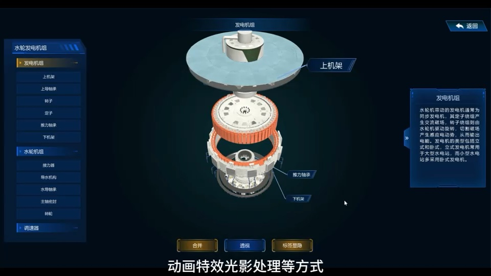
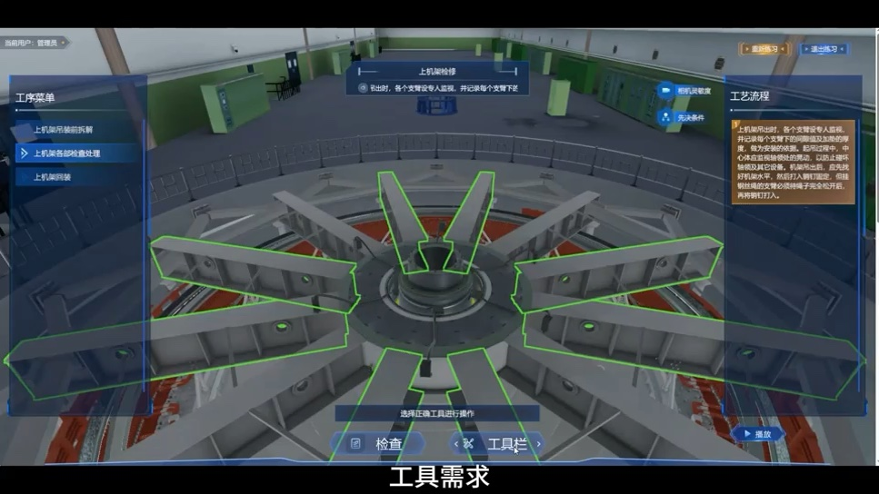
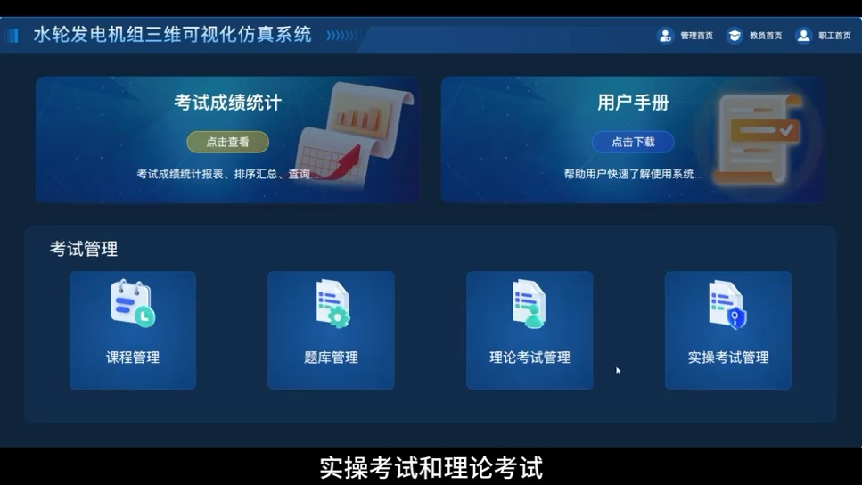

# 水轮机组三维检修平台

面向水电机组检修培训的三维可视化项目展示，涵盖设备结构认知、检修流程学习与培训考核。

> **仓库说明：本仓库代码仅为 Vue Hello World 与前端架构示意，未实现视频中的三维检修、培训考试及管理功能。项目视频仅作为项目演示参考，不代表运行本仓库即可获得视频中的完整系统。**

## 项目简介

水轮机组三维检修平台面向水电站设备检修与技能培训场景，通过三维模型、拆装动画和工序引导，将水轮发电机组的结构组成、部件关系与检修流程直观呈现。演示围绕“认识设备—学习工序—模拟操作—培训考核”展开，展示了机组及零部件的多角度观察、爆炸与组合展示、部件标签、设备资料和图纸查看，以及结合工具选择、部件高亮和步骤提示的检修学习过程。同时，视频展示了课程与题库管理、理论及实操考试、教师阅卷、成绩统计与记录导出等培训管理界面，为设备认知、检修教学和技能训练提供可视化参考。

以上简介依据本仓库所附演示视频整理；视频所用三维引擎、后台技术栈和实际部署情况不由本示例代码推定。

## 项目演示

下方为完整时长的在线播放压缩版（约 6 分钟，保留音轨）。查看图纸或界面细节，建议下载原视频。

https://github.com/user-attachments/assets/ca9405f4-b02b-4ad7-b30a-1596d72f80cd

[下载原视频（约 34.6 MB）](https://github.com/caliwon2077/hydro-turbine-3d-maintenance/releases/download/demo-v1/hydro-turbine-demo-original.mp4) · [演示资料下载页](https://github.com/caliwon2077/hydro-turbine-3d-maintenance/releases/tag/demo-v1)

### 视频展示的主要内容

| 内容 | 演示中可见的功能 | 参考画面位置 |
| --- | --- | --- |
| 机组结构认知 | 发电机组、水轮机组及部件的分层展示、爆炸与组合、标签标注、多角度观察 | 约 00:45、01:15、01:30 |
| 设备资料与原理学习 | 资料上传管理、图纸查看、设备参数展示、运行动画 | 约 01:45、02:00、02:15 |
| 三维检修学习 | 工序菜单、工艺流程、工具栏、操作对象高亮、步骤引导；示例涉及上机架与导水机构 | 约 03:00、03:30、04:00 |
| 培训与考试 | 课程、题库、理论考试和实操考试管理；三维操作场景中的计时与交卷入口 | 约 04:15、04:45、05:00 |
| 阅卷与成绩管理 | 教师阅卷和分数调整、考试记录查询、成绩统计、表格导出 | 约 05:15、05:30、05:45 |

### 演示画面

**机组结构与部件标注**



**三维检修工序与操作引导**



**培训与考试管理入口**



截图均提取自演示视频，不是本仓库 Vue 示例的运行画面。

## Vue Hello World

当前源码是一个最小的 **Vue 3 + Vite** 示例，包含：

- 应用入口与 Vue 单文件组件；
- `Hello World!` 页面与响应式点击计数；
- 项目标题、仓库用途说明和介绍页链接；
- 开发、构建与构建预览命令。

代码仅展示前端项目的基础组织方式，未接入三维模型、三维渲染引擎、后端接口或数据库。Vue 与 Vite 是本示例选用的技术，不代表演示系统的实际技术选型。

### 本地运行

Node.js 要求：`^22.18.0 || >=24.12.0`。

```bash
git clone https://github.com/caliwon2077/hydro-turbine-3d-maintenance.git
cd hydro-turbine-3d-maintenance
npm ci
npm run dev
```

访问终端显示的本地地址。

```bash
# 生成 dist/ 构建产物
npm run build

# 在本地预览构建产物
npm run preview
```

### 目录结构

```text
hydro-turbine-3d-maintenance/
├── docs/media/        # 从项目演示视频提取的截图
├── src/
│   ├── App.vue        # Hello World、点击计数与用途说明
│   ├── main.js        # Vue 应用入口
│   └── style.css      # 示例页面样式
├── index.html
├── package.json
├── package-lock.json
├── vite.config.js
└── README.md
```

视频通过 GitHub 附件与 Release 提供，克隆代码仓库时无需下载视频。
